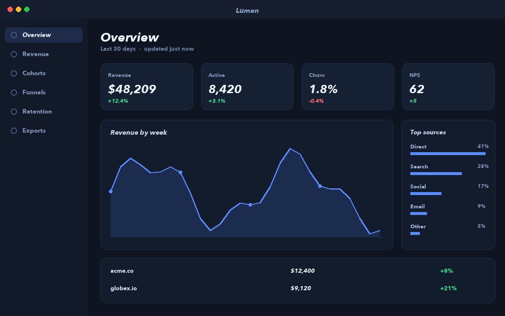
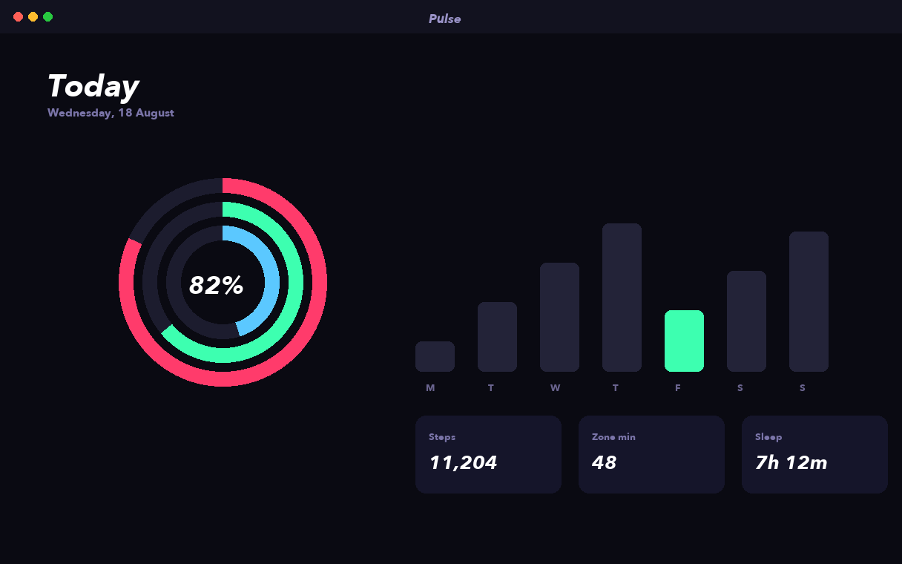
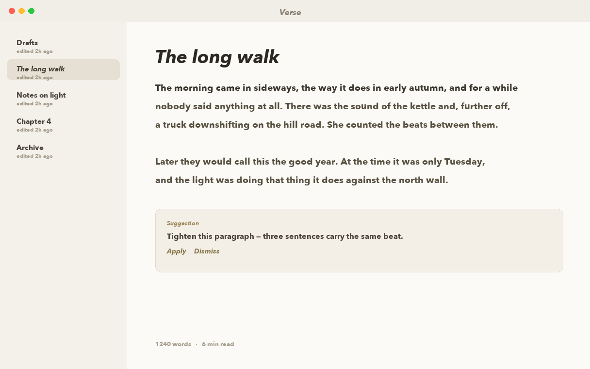
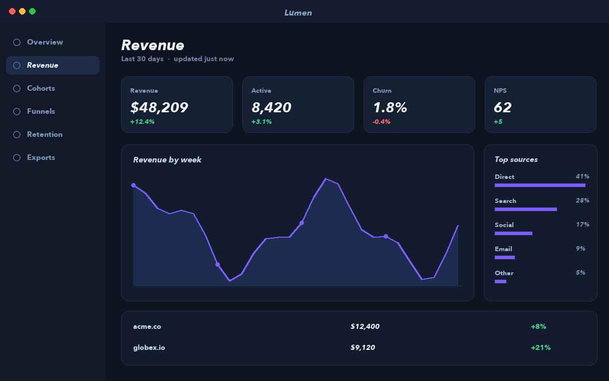
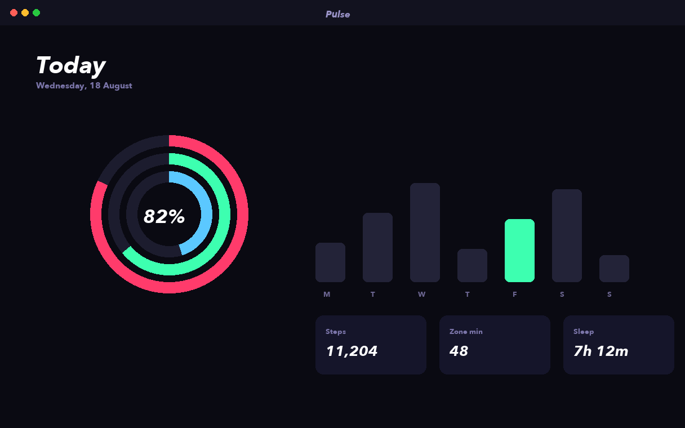
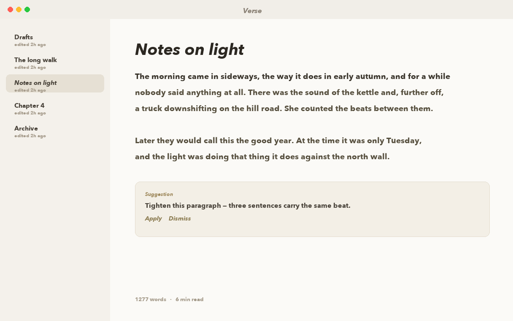
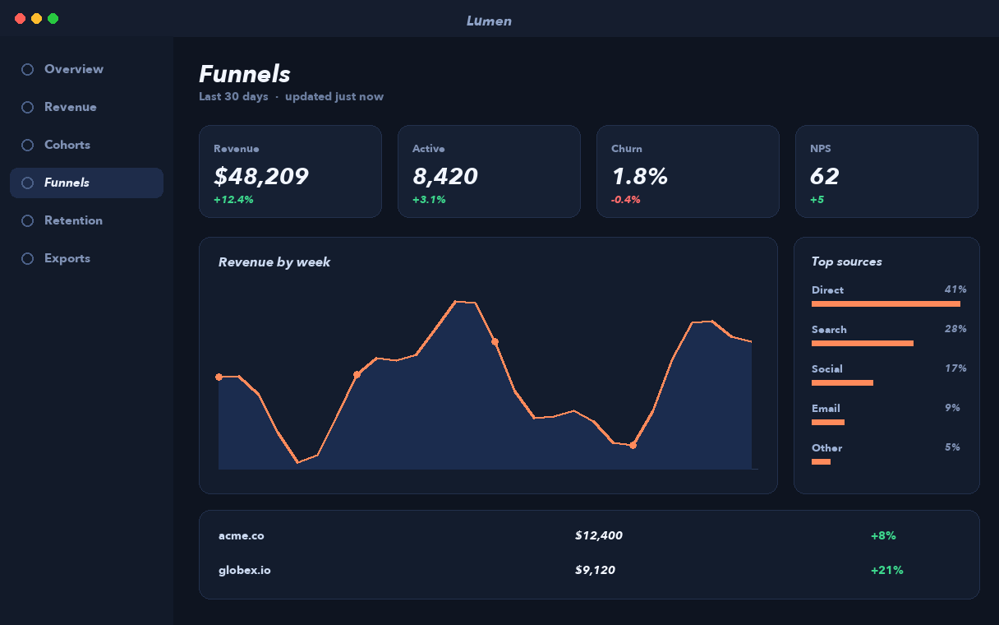
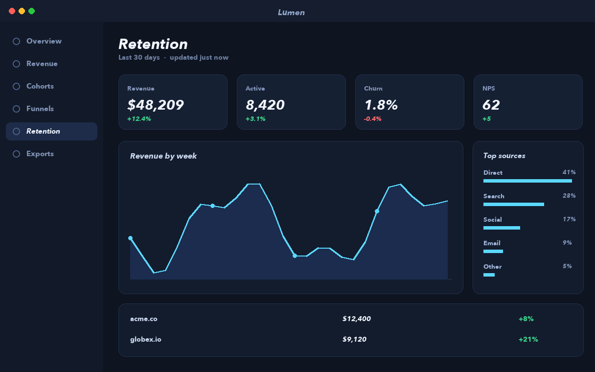
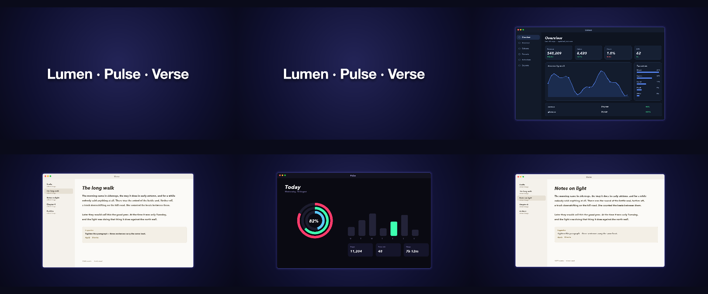
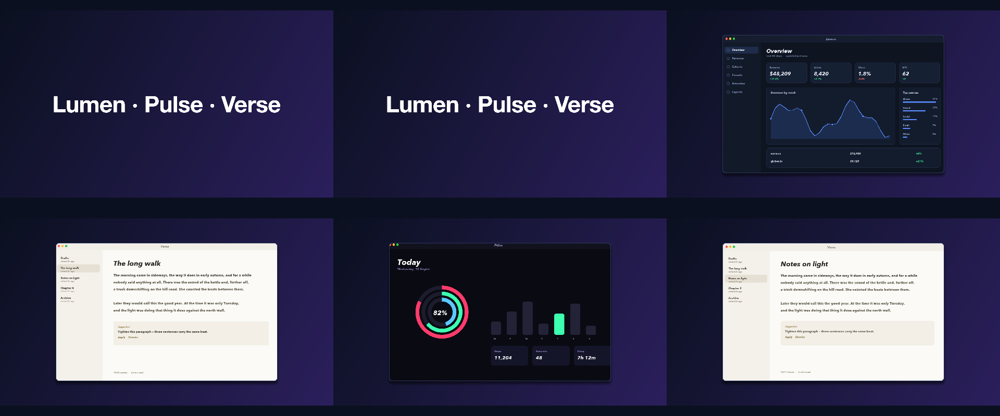

# 36 Beat Cut

Eight screenshots cut to a song promo measures itself — two beats each, then one beat after the lift — with a punch on every downbeat, a flash at the lift and a title that lands on bar 1.

*1920×1080, 28 s.* Part of [the demos](../../demo.md): a fresh agent, the media and the prompt below, the public skill and the headless MCP, nothing else.

## Resources given to the agent

 
 
 
 
 
 
 
 
`lift_song.wav` ([file](../../demos/_media/lift_song.wav))

## The prompt

> Make an energetic beat-cut promo of these app screenshots to this track, about 28 seconds — the whole song. Open on a dark gradient with the title landing on the first downbeat, then cut between the screenshots on the beat, cycling through them: every two beats in the first half, every beat once the music lifts. Give each screenshot a punch on the downbeats, put a white flash where it lifts, and finish on the closing line, ending on a downbeat. I may swap the track later, so let the cuts follow the beats measured from the music rather than fixed times. The track is our own (made with ffmpeg, CC0) — record that on it so it shows in the credits.
> 
> Files in `resources/`: ui_lumen_1.png, ui_pulse_1.png, ui_verse_1.png, ui_lumen_2.png, ui_pulse_2.png, ui_verse_2.png, ui_lumen_4.png, ui_lumen_5.png, lift_song.wav.
> 
> Text to use, in order:
> - Lumen · Pulse · Verse
> - Three apps. One beat.

## What the agent made

Score **93%** (14 of 15 rubric checks).

| the agent's work | |
|---|---|
| turns | 24 |
| wall time | 1 min 41 s (API 1 min 32 s) |
| cost at API list price | $0.90 — on a Claude subscription this is plan usage, not a bill |
| tokens in | 1.0M (958k cache read, 64k cache write) |
| tokens out | 10k (3k thinking) |
| claude-opus-5-5 | 1.0M in, 10k out, $0.90 |

| MCP tool | calls | time |
|---|---|---|
| promo_render_video | 1 | 6 s |
| promo_beats | 1 | 1 s |
| promo_render_frames | 1 | 0 s |
| promo_media_probe | 1 | 0 s |
| promo_validate | 2 | 0 s |
| promo_inspect | 1 | 0 s |
| promo_explain | 1 | 0 s |
| promo_schema_full | 3 | 0 s |
| **all** | 11 | 7 s |

Six moments:

**[▶ Watch the video](https://github.com/garalex/promoshot/raw/demo-media/36-beat-cut.mp4)** (1280 wide, 1.7 MB) · [small copy](36-beat-cut/result.mp4) · [the project it wrote](36-beat-cut/result-metadata.json)

| check | | detail |
|---|---|---|
| duration | ✓ | 28.4s vs 28.4s |
| kind:background | ✓ | 1 vs 1 |
| kind:audio | ✓ | 1 vs 1 |
| kind:image | ✗ | 1 vs 32 |
| kind:caption | ✓ | 2 vs 2 |
| feature:gradient | ✓ | True |
| feature:beatClock | ✓ | True |
| feature:measuredClock | ✓ | True |
| feature:musicalTime | ✓ | True |
| feature:beatCuts | ✓ | 36 vs 32 |
| feature:pulse | ✓ | True |
| feature:flash | ✓ | True |
| feature:provenance | ✓ | True |
| phrases | ✓ | 2 of 2 lines recognisable |
| onBeat | ✓ | 41 of 43 cuts in export.mp4 within a frame of a beat; off: 0.3s (+45 ms), 22.9s (+145 ms) |

## The hand-built reference, same moments

---

[← all demos](../../demo.md) · [how the suite works](../../demos/README.md)
